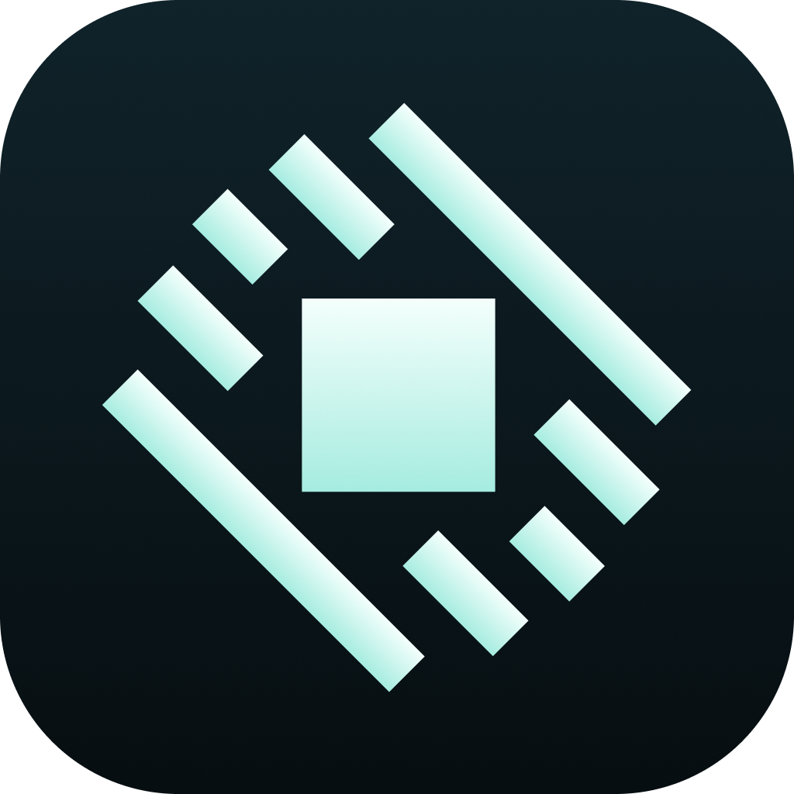

<h1 align="center">
  <br>
  <a href="https://github.com/nobberu/slipway"></a>
  <br>
  Slipway
  <br>
</h1>

<h3 align="center">
  Where everything launches.
</h3>

<br>
<p align="center">
  <a href="https://github.com/thatshubham/no-ai">
    
  </a>
  <a href="LICENSE">
    
  </a>
</p>

Say hello to **Slipway**, a small launcher for your desktop. Type a few letters, pick an app or a game, and you're on your way.

Not a command center, Slipway does one thing, on purpose. It gets you from a few keystrokes to the thing you wanted to open. Most launchers keep growing into app platforms. Slipway stays small, light, and out of the way.

> **Slipway is early.** Search, apps, games, and icons work. The global hotkey and full keyboard navigation are next. See [What's Inside](#whats-inside) for what's done.

<p align="center">
  
</p>

---

## Features & Highlights (Not functional yet. Check [roadmap](#roadmap) below)

- **Finds everything:** Classic apps, Microsoft Store apps, and games, all in one list.
- **Knows your games:** Games from Steam, and from other launchers that register a launch link, are tagged as games and open straight through their launcher.
- **Real icons:** Every result uses the same icon Windows shows in Explorer.
- **Smart search:** Exact and prefix matches come first, then word matches, then looser ones. Typing "tm" finds Task Manager.
- **Light & Fast:** A native UI built with Rust and Slint, with no webview and no browser engine running in the background.
- **Private:** Everything stays on your machine. Slipway reads your app list from Windows and never sends it anywhere.

---

## Installation

Check the [Releases](https://github.com/nobberu/slipway/releases) page for the latest build.

- **Windows:** Supported first. Download the latest `.exe`.
- **macOS and Linux:** Planned. Finding apps, launching them, and window behavior are platform-specific and will be ported after Windows.

---

## Building from Source

### Prerequisites

- [Rust](https://www.rust-lang.org/tools/install). On Windows, the installer will also ask you to install the Microsoft C++ Build Tools.
- Windows PowerShell, which already comes with Windows. Slipway uses it to list your installed apps.

That's all you need.

### Setup Steps

1. **Clone the Repository:**

```bash
git clone https://github.com/nobberu/slipway.git
cd slipway
```

2. **Run in Development:**

```bash
cargo run
```

The first build compiles Slint and takes a while. Later builds are much faster.

3. **Build Release Binary:**

```bash
cargo build --release
```

The executable ends up in `target/release/`.

### Editing the UI

The interface lives in `ui/main.slint`, separate from the Rust code. For a live preview while you edit, install the **Slint** extension for VS Code and use **Show Preview**, or run the standalone viewer:

```bash
cargo install slint-viewer
slint-viewer --auto-reload ui/main.slint
```

---

## What's Inside

- **Search:** Type to filter. Results are ranked by how well they match.
- **Apps & Games:** Everything the Start menu lists, with games tagged and icons loaded in the background.
- **System commands:** Lock Screen, Sleep, Restart, Shut Down, etc.
- **Global hotkey:** Open and close Slipway from anywhere.
- **Keyboard navigation:** Arrow keys to move, Enter to launch, Esc to close.

---

## Roadmap

- [x] Native launcher window in Rust and Slint
- [ ] List installed apps and Microsoft Store apps
- [ ] Detect games and tag them
- [ ] Real app icons from Windows
- [ ] Ranked search
- [ ] Global hotkey to open and close
- [ ] Keyboard navigation
- [ ] Close when you click away
- [ ] Restart and Shut Down, with a confirmation step
- [ ] Remember what you open most
- [ ] Calculator and quick actions
- [ ] macOS and Linux support

---

## What Slipway Won't Do

> **Note:** If it isn't about getting you to something fast, it doesn't live in the slipway.
>
> - No account or sign-in
> - No telemetry
> - No webview
> - No background services

---

## Contributing

Contributions, feedback, and ideas are welcome! Feel free to open an issue or submit a pull request.

---

## Acknowledgments & Tech Stack

Slipway is built using these tools and frameworks:

- **[Rust](https://www.rust-lang.org/)** — The language behind Slipway's logic and window handling.
- **[Slint](https://slint.dev/)** — Declarative native UI toolkit, used under the GPLv3.
- **[windows](https://github.com/microsoft/windows-rs)** — Windows API bindings, used to launch apps and read their icons.

---

## License

This project is licensed under the [GNU General Public License v3.0](LICENSE).
Slipway uses [Slint](https://slint.dev/) under the GPLv3.
